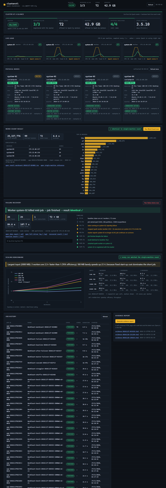
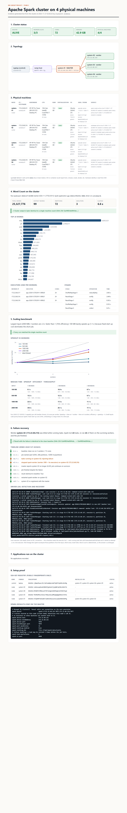

# Implementation of an Apache Spark Cluster on Physical Machines and the Word Count Problem

**Course:** IBD (Introduction to Big Data) — Group Project
**Group:** Team 2
**Members:**

| Name | Roll number |
|------|-------------|
| _Member 1_ | _Roll no._ |
| _Member 2_ | _Roll no._ |
| _Member 3_ | _Roll no._ |
| _Member 4_ | _Roll no._ |

**Evaluation date:** 30 November 2026
**Code repository:** `github.com/saumilyagupta/SparkFleet`

> Every number in this report comes from real runs on our four lab machines between 26 and 27 November 2026. The raw outputs (JSON summaries, Spark driver logs, generated reports and screenshots) are committed in `docs/results/`, so each figure can be traced to its source file.

---

## Abstract

We built an Apache Spark 3.5.10 standalone cluster on four physical lab PCs, each an HP Pro Tower 280 G9 with a 24-core Intel i7-13700 and 15.3 GB of RAM. One PC is the master and three are workers, giving the cluster 72 executor cores and 42.9 GB of executor memory. We implemented Word Count in PySpark and ran it on the cluster. On a 100 MB input (25,327,776 words) its output was byte-identical to a single-machine count.

We wrote a tool, `clusterctl`, that sets up the whole cluster from one command. It keeps the machine list in an inventory file and their passwords in an encrypted vault, and installs SSH keys automatically, recording each in a key registry. It runs every step over SSH through a jump host and installs Spark as systemd services.

We then tested how Spark survives failures:
- **A worker killed mid-job:** 24 running tasks were lost and re-run on the surviving machines, and the result was unchanged.
- **A worker lost during the shuffle:** Spark re-ran the earlier map stage for the lost data.
- **A worker slowed to one CPU core:** Spark started backup copies of its tasks (speculative execution).
- **Two workers lost one after the other:** the job finished on the last worker.
- **The master killed:** we added ZooKeeper-based master high availability, and a standby master took over in 33 s while the job kept running.

Every one of these runs produced an answer identical to the single-machine count.

Finally, a scaling benchmark of 36 runs showed a **2.28× speedup with 3 workers on a 2 GB input**, at 76% efficiency. On a 100 MB input the speedup was negligible, which is the behaviour Amdahl's law predicts when fixed overheads dominate.

---

## 1. Introduction

Apache Spark is a distributed data-processing engine. It keeps data in memory as **Resilient Distributed Datasets (RDDs)**: immutable collections split into partitions that are processed in parallel. Spark does not replicate the data. Each RDD remembers its **lineage**, the chain of transformations that produced it, so a lost partition can simply be recomputed. This is the basis of Spark's fault tolerance.

The assignment had four requirements:

1. Set up a Spark cluster on **physical machines**. Virtual machines and a single-node setup were not allowed.
2. Implement **Word Count** and run it on that cluster.
3. Demonstrate the working cluster and explain the setup and the code.
4. Show and explain **how Spark recovers from a failure**.

We went further. The whole setup is automated and repeatable, and it is designed to grow from 4 machines to 100. We added a dashboard and an offline evidence report. We also tested four more kinds of failure and measured how performance scales with the number of workers.

---

## 2. System overview

### 2.1 Hardware

All four machines report `systemd-detect-virt = none`, which means they are bare metal, not virtual machines. Their hardware identity was read from the firmware's DMI tables (`/sys/class/dmi/id`).

| Node | Role | Hostname | IP | Machine | CPU | RAM | OS |
|------|------|----------|----|---------|-----|-----|----|
| system-01 | Spark master + driver (+ History Server) | cselab2pc36 | 172.22.68.221 | HP Pro Tower 280 G9 | i7-13700, 24 threads | 15.3 GB | Ubuntu 24.04.3 |
| system-02 | worker (+ standby master, ZooKeeper) | cselab4pc27 | 172.22.68.216 | HP Pro Tower 280 G9 | i7-13700, 24 threads | 15.3 GB | Ubuntu 24.04.5 |
| system-03 | worker (+ ZooKeeper) | cselab4pc34 | 172.22.68.217 | HP Pro Tower 280 G9 | i7-13700, 24 threads | 15.3 GB | Ubuntu 24.04.3 |
| system-04 | worker (+ ZooKeeper) | cselab4pc25 | 172.22.68.218 | HP Pro Tower 280 G9 | i7-13700, 24 threads | 15.3 GB | Ubuntu 24.04.5 |

The software is the same on every node: OpenJDK 17.0.21, Python 3.12 and Spark 3.5.10 (built for Hadoop 3).

### 2.2 Architecture

```
  Control laptop (clusterctl + dashboard)          — never part of the cluster
        │  SSH (keys), tunnelled through the jump host QWERTY-GPU-clg
        ▼
  ┌──────────────────────────── lab LAN 172.22.68.0/24 ─────────────────────────────┐
  │  system-01 (master)          system-02            system-03           system-04 │
  │  Spark master :7077          Worker (24 cores)    Worker (24 cores)   Worker    │
  │  Driver (spark-submit)       Standby master       ZooKeeper           ZooKeeper │
  │  History Server :18080       ZooKeeper                                          │
  │          ◄──── task scheduling, results ────►   ◄── shuffle blocks between ──►  │
  │                                                     executors                   │
  └──────────────────────────────────────────────────────────────────────────────────┘
```

**Cluster manager**
- We use Spark's standalone cluster manager.
- The master tracks workers through heartbeats and gives each application its executors.

**Deploy mode**
- Jobs run in client mode, so the driver (`spark-submit`) runs on system-01.
- Executors on the workers connect back to the driver on fixed ports: 7078 for the driver and 7079 for the block manager.

**Storage**
- We do not use HDFS.
- The input file is copied to the same local path, `/opt/spark-data/input/`, on every node.
- Every copy is checked with SHA-256.

**Network**
- The lab machines cannot be reached directly from the laptop. All control traffic goes through an SSH jump host.
- The SSH session to each node is encrypted end to end, so lab passwords are never visible on the jump host.


*Figure 1: The live dashboard during a Word Count run. It shows the cluster status, per-machine CPU and Spark cores in use, the physical-machine cards, the Word Count result, the failure-recovery timeline, the scaling chart and the job history.*

---

## 3. Setting up the cluster

We automated the setup with a Python tool, `clusterctl`, which uses Paramiko for SSH. This makes the cluster reproducible, lets us grow it to more machines without manual work, and keeps credentials safe. The full step-by-step guide is in `docs/SETUP.md`.

### 3.1 Machine list and passwords

| File | Contents | Committed to git? |
|------|----------|-------------------|
| `inventory.yaml` | Name, IP, user and role of each host, plus cluster settings | No (an example is committed) |
| `secrets.vault` | Host passwords, encrypted. The key is derived from a master password with scrypt (N=2^15, r=8, p=1), and the data is encrypted with Fernet (AES-128-CBC plus HMAC-SHA256) | Never |
| `keys/registry.json`, `keys/audit.log` | Every SSH key placed on the cluster: fingerprint, owner, hosts and status, plus an append-only event log | Never |

The lab gave us a `systems.json` file with the IPs, usernames and passwords. It was imported in one step with `clusterctl init --systems systems.json --jump QWERTY-GPU-clg`.

- The first system becomes the master unless `--master` names another one.
- The tool **refuses** to make the control laptop the master.
- After the first contact, passwords are used only for `sudo`. Every login uses SSH keys.

### 3.2 One-command setup: `clusterctl up`

`up` runs four steps, in parallel across all hosts:

1. **Bootstrap**
   - Pin each host's SSH host key; a changed key is rejected later.
   - Install the laptop's ed25519 control key.
   - Create a key on each node.
   - Authorize the master's key on the workers.
   - Record every key in the key registry.
2. **Provision**
   - Preflight checks: sudo works, the OS is Debian-family, there is enough disk, and the node can reach its peers.
   - Install OpenJDK 17 and Python 3.
   - **Check that every node runs the same Python minor version.** PySpark fails if the driver and the executors use different versions.
   - Download Spark on each node and **verify its SHA-512** against apache.org.
   - Generate `spark-env.sh` and `spark-defaults.conf` from templates.
   - Install systemd units: `spark-master` and `spark-worker`, both with `Restart=on-failure`.
   - Write a managed block into `/etc/hosts`, and add firewall rules if ufw is active.
3. **Start:** the master first, then the workers.
4. **Verify:** wait until the master's `/json/` endpoint reports every worker as ALIVE.

Every step can be run again safely. Re-running `up` changes nothing. Adding a machine takes one inventory line plus `clusterctl up --limit <name>`.

### 3.3 Problems we hit and how we solved them

| Problem | Cause | Solution |
|---------|-------|----------|
| The lab IPs were unreachable from the laptop | The lab network is isolated | Tunnel SSH through a jump host with `direct-tcpip` channels (the same mechanism as `ssh -J`) |
| Workers could bind to the wrong address | Ubuntu maps the hostname to 127.0.1.1 | Set `SPARK_LOCAL_IP` to each node's LAN IP |
| Pushing 400 MB of Spark through the jump host was slow | Limited bandwidth to the lab | Nodes download Spark themselves, and the official SHA-512 is still checked. Data files are uploaded once to the master, which copies them to the workers over the LAN |
| Bootstrapping in parallel corrupted the key registry | Threads raced on a temp file | Serialize registry writes with a lock |
| The Spark UI tunnel on the laptop showed a Postgres page | A local service already owned port 8080 | Local tunnel ports are the Spark ports plus 10000 (18080, 14040, …), and the next free port is used if one is busy |
| ZooKeeper's admin server would clash with the Spark UI | Both use port 8080 by default | Set `admin.enableServer=false` |

---

## 4. The Word Count program

The source is `jobs/wordcount.py`, written with PySpark's RDD API:

```python
lines  = sc.textFile("file:///opt/spark-data/input/corpus.txt", 72)     # 72 partitions
counts = (lines.flatMap(tokenize)                  # line -> words        (narrow)
               .map(lambda w: (w, 1))             # word -> (word, 1)    (narrow)
               .reduceByKey(lambda a, b: a + b)   # shuffle by word, sum (wide)
               .sortBy(lambda kv: (-kv[1], kv[0])))   # count desc, word asc
results = counts.collect()
```

**How it works**
- `tokenize` lower-cases each line and extracts words made of letters and digits, keeping an apostrophe inside a word (for example "don't").
- `reduceByKey` first adds up counts inside each partition (a *combiner*). Only the partial sums are shuffled across the network, which keeps the shuffle small.
- Spark splits the job into stages at each shuffle:
  - **ShuffleMapStage 0** (2.97 s): read the input, split into words, make (word, 1) pairs, and pre-combine.
  - **ResultStage 1** (2.44 s): Spark's `sortBy` samples the data to decide the sort ranges.
  - **ShuffleMapStage 5 → ResultStage 6** (0.32 s + 0.27 s): the range-partitioned sort and the `collect`.

**Correctness**
- `jobs/local_count.py` counts the same file on one machine with the same tokenizer.
- The cluster's output file was **byte-identical** to it (same SHA-256).

**Typical run** (`clusterctl run --input corpus.txt --partitions 72`)

| Metric | Value |
|--------|-------|
| Input | 100 MB, deterministic synthetic text (fixed seed, Zipf-like word frequencies) |
| Total words / distinct words | 25,327,776 / 99 |
| Executors | 3 (one per worker, 24 cores each) |
| Partitions | 72 |
| Elapsed time | 6.6 s |
| Top words | the 4,893,021 · of 2,448,671 · and 1,630,966 · to 1,222,605 · in 978,175 |

---

## 5. Fault tolerance: how Spark recovered from failures

We automated every failure experiment. Each one:
- starts a job,
- injects a real fault on a real machine,
- waits for the job to finish,
- checks the answer against the single-machine count,
- restores the cluster.

The full reports and driver logs are in `docs/results/demo-*.md` and `docs/results/demo-*.log`.

### 5.1 Experiment 1: a worker dies mid-job (the assignment requirement)

**How we injected the fault**
- We ran Word Count with 288 partitions, slowing each one down by 12 s so the job takes long enough to observe.
- As soon as system-02 was running tasks, we ran `systemctl stop spark-worker` on it.
- Because of `KillMode=control-group`, this kills the worker JVM **and** its executor JVM. To Spark it is the same as the machine dying.

| Time | Event |
|------|-------|
| +13.6 s | Job started: 288 partitions on 3 executors × 24 cores |
| +16.5 s | Tasks running on system-02; fault injected |
| +17.1 s | `spark-worker` stopped on system-02, so its executor is gone |
| +20.5 s | The master no longer lists system-02 as ALIVE. The job continues on system-03 and system-04 |
| +102.8 s | The job finishes. The result is **identical** to the clean run (SHA-256 `12af4f834e0941eb…`) |
| +106.9 s | system-02 is restarted and re-registers with the master |

**Driver log** (abbreviated)

```
ERROR TaskSchedulerImpl: Lost executor 0 on 172.22.68.216: Worker shutting down
WARN  TaskSetManager: Lost task 23.0 in stage 0.0 (TID 23) (172.22.68.216 executor 0): ExecutorLostFailure
      ... 24 tasks lost (all tasks running on that executor)
INFO  DAGScheduler: Executor lost: 0 (epoch 0)
INFO  TaskSetManager: Starting task 0.1 in stage 0.0 (TID 48) (172.22.68.217, executor 2, partition 0)
INFO  TaskSetManager: Finished task 0.1 in stage 0.0 (TID 48) in 14846 ms on 172.22.68.217
INFO  DAGScheduler: ShuffleMapStage 0 (reduceByKey) finished in 78.7 s
```

**How Spark recovered**

1. **Detection.**
   - When the executor JVM died, its RPC connection to the driver closed.
   - The scheduler marked the executor as lost, and each task that was running on it failed with `ExecutorLostFailure`.
   - The master separately removed the worker when its connection dropped. Heartbeats, with `spark.worker.timeout` = 60 s, are the backup for failures that don't close a connection.
2. **Task retry.**
   - Each lost task was put back into the queue as a new *attempt*: partition 0 attempt 0 became attempt 1 (`task 0.1`).
   - The new attempt ran on a free core of a surviving executor.
   - A lost executor does not count against the task's retry limit (`spark.task.maxFailures` = 4).
3. **Lineage.**
   - A partition is a *recipe*, not stored data: `textFile(split i) → flatMap → map → combine`.
   - The input split still exists on the surviving nodes, so the lost partitions were recomputed from scratch.
4. **Determinism.**
   - Every transformation is deterministic, and addition is associative and commutative.
   - So re-running a partition gives the same partial counts, and the final answer is unchanged.

### 5.2 Experiment 2: a worker dies *during the shuffle*

**How we injected the fault**
- We slowed down the reduce side of the job with `--reduce-delay-ms`, so the shuffle read takes long enough to hit.
- We killed system-02 **after** the map stage had finished and while the reduce stage was reading shuffle data.

**What went wrong**
- system-02's map outputs (its shuffle files) were stored only on its own disk, because there is no external shuffle service.
- Reduce tasks that needed those files failed with `FetchFailed`.

| Measurement | Value |
|-------------|-------|
| FetchFailed log lines | 14, all for the same lost map output |
| Stage resubmissions | 1 (`Resubmitting ShuffleMapStage 0 … due to fetch failure`) |
| Job time | 51.3 s (map stage done at 16.7 s, worker killed at 17.4 s) |
| Result | Identical to the single-machine count |

**Why this matters:** retrying the task is not enough here, because the data the task needs is gone. The DAGScheduler followed the lineage back across the stage boundary. It **re-ran the earlier map stage, but only for the missing partition**, then let the reduce stage continue.

### 5.3 Experiment 3: a slow node (speculative execution)

**How we injected the fault**
- Input: the 2 GB file, split into 432 partitions. These tasks are CPU-bound.
- Spark settings: `spark.speculation=true`, `spark.speculation.multiplier=1.5`, `spark.speculation.quantile=0.5`.
- 3.6 s into the job, we limited system-02 to **one CPU core** with a real Linux cgroup quota: `systemctl set-property --runtime spark-worker CPUQuota=100%`. Its 24 task slots now shared a single core, which made it a genuine straggler rather than a simulated one.

| Measurement | Value |
|-------------|-------|
| Tasks marked speculatable | 97 |
| Speculative copies that finished first (the original attempt was killed) | 64 |
| Job time | 36.9 s (17.1 s with 3 healthy workers in the benchmark) |
| Result | Identical; the CPU quota was removed afterwards |

**What happened:** Spark noticed that system-02's tasks were running much longer than the median task. It launched duplicate copies of them on the healthy workers and kept whichever copy finished first. Fault tolerance covers slow machines too, not only crashed ones.

### 5.4 Experiment 4: two workers die one after the other

**How we injected the fault**
- We stopped system-02 at +5.7 s.
- We stopped system-03 at +28.8 s.

**What happened**
- The job finished at +111.3 s on system-04 alone, with 24 cores.
- 48 tasks were lost in total.
- Completed map outputs that had lived on the dead machines were recomputed: the log shows 48 `Resubmitted ShuffleMapTask` messages.
- Both workers were restarted, and the result was identical.

### 5.5 Experiment 5: the master dies (high availability)

**The problem**
- With a single standalone master, the master is a **single point of failure**.
- Running jobs keep going if it dies, but no new application or worker can register.

**Our fix**
- A **ZooKeeper 3.8.8 ensemble** runs on system-02, 03 and 04. Three nodes means it keeps a majority even if one fails.
- A **standby master** runs on system-02.
- Both masters run with `spark.deploy.recoveryMode=ZOOKEEPER`, and ZooKeeper elects one of them ALIVE.
- Workers and drivers are given both addresses: `spark://172.22.68.221:7077,172.22.68.216:7077`.

| Time | Event |
|------|-------|
| +1.3 s | system-02 is ALIVE (ZooKeeper elected it), system-01 is STANDBY |
| +3.2 s | Job started: 864 partitions, designed to run for more than 2 minutes |
| +18.9 s | `spark-master` stopped on system-02, so the active master is down |
| +52.2 s | ZooKeeper elects system-01; it recovers the worker and application state and becomes **ALIVE after 33 s**. The job is still running |
| +144.4 s | The running job finishes under the new master |
| +156.8 s | A **new** application is submitted and runs on the new master, with an identical result |
| +161.8 s | system-02 is restarted and rejoins as STANDBY |

**Limitation**
- High availability protects the *master service*.
- In client mode, the driver still runs on system-01.
- PySpark on a standalone cluster does not support cluster deploy mode, so Spark cannot supervise and restart the driver.
- In production, the driver would run on a separate gateway machine.

We also tested turning HA off again. Setting `ha_enabled: false` and re-running `provision` removed ZooKeeper and the standby master from every machine. The cluster returned to one master with 3/3 workers, and Word Count stayed correct. We then turned HA back on.

### 5.6 Summary of the fault-tolerance experiments

| # | Fault | Spark mechanism | Tasks lost | Recovery evidence | Result |
|---|-------|-----------------|-----------|-------------------|--------|
| 1 | Worker killed mid-job | Task retry + lineage | 24 | 24 retried as attempt `.1` | Identical ✓ |
| 2 | Worker killed during the shuffle | FetchFailed → stage resubmission | 23 | ShuffleMapStage 0 resubmitted | Identical ✓ |
| 3 | Node throttled to 1 CPU core | Speculative execution | — | 97 speculatable, 64 copies won | Identical ✓ |
| 4 | Two workers killed 20 s apart | Retry + map-output recomputation | 48 | 48 map tasks resubmitted | Identical ✓ |
| 5 | Active master killed | ZooKeeper leader election | 0 | Standby ALIVE in 33 s; new app ran | Identical ✓ |

---

## 6. Scaling benchmark

**Method**
- **Inputs:** 100, 500, 1000 and 2000 MB, generated on the master with a fixed seed and copied to the workers.
- **Worker count:** each run used 1, 2 or 3 workers, chosen with `--executor-cores 24 --total-executor-cores 24·k`. This places exactly *k* executors on *k* different machines without stopping any service.
- **Repeats:** 3 per combination, 36 runs in total, all at 216 partitions. We report the median time.
- **Metrics:** speedup S(k) = T(1)/T(k), and efficiency = S(k)/k.
- **Correctness:** every run's output was checked against a single-machine count of the same file. **All 36 matched.**

| Input | 1 worker (24 cores) | 2 workers (48 cores) | 3 workers (72 cores) | Speedup at 3 workers | Efficiency at 3 workers | Throughput at 3 workers |
|-------|------|------|------|------|------|------|
| 100 MB | 9.1 s | 10.0 s | 8.7 s | 1.05× | 35% | 11.5 MB/s |
| 500 MB | 13.2 s | 12.2 s | 9.7 s | 1.36× | 45% | 51.5 MB/s |
| 1000 MB | 22.5 s | 17.5 s | 11.1 s | 2.03× | 68% | 90.1 MB/s |
| 2000 MB | 39.0 s | 28.1 s | 17.1 s | **2.28×** | **76%** | **117.0 MB/s** |


*Figure 2: The generated evidence report. Section 5 of the report shows the speedup against the number of workers for each input size, with the ideal linear speedup as a dashed line.*

**Analysis**

- **Amdahl's law in practice.**
  - Each Spark job has a fixed cost that does not shrink when we add machines: starting executors and the Python workers, scheduling 216 tasks, the shuffle, the extra sampling job used by `sortBy`, and collecting results to the driver.
  - On 100 MB that fixed cost is most of the 9 s runtime, so 3 machines are barely faster than 1 (1.05×).
  - As the input grows, the parallel part (reading and tokenizing) dominates. Speedup rises to 2.03× at 1 GB and 2.28× at 2 GB.
- **Efficiency below 100%** reflects the serial parts of the job, the shuffle crossing the network, and stragglers in the last wave of tasks.
- **Throughput** grows from about 51 MB/s on one machine to 117 MB/s on three for the 2 GB input. We would expect the curve to keep approaching linear for larger inputs.

---

## 7. Monitoring and auditability

- **Spark History Server.** It runs as a systemd service on the master and rebuilds the full Spark UI for every finished application from its event logs. It survives master restarts, which the master's own list of finished applications does not. All 59 applications run so far are browsable, including the failed and retried task attempts of the fault experiments.
- **Live load.** The dashboard samples `/proc/stat`, `/proc/meminfo` and `/proc/loadavg` on each machine every 3 s. It plots CPU next to the cores Spark is using, which shows the workers going from 0 to 24 Spark cores during each job (Figure 1).
- **Evidence report.** `clusterctl evidence` produces one offline HTML page with the status, topology, physical machines, Word Count, scaling, recovery, job history and setup proof. It contains no passwords or private keys.

---

## 8. Engineering quality

- **Tests:** 303 automated tests cover the inventory, vault, key registry, templates, provisioning helpers, log parsing, scenarios, HA configuration, dashboard routes and the archive's secret scanning.
- **Independent code review:** every feature was reviewed before it was used live. Findings were fixed with regression tests, for example a deadlock in the dashboard sampler and the guarantee that every fault demo restores the cluster even if something fails midway.
- **Security**
  - Passwords are encrypted at rest and never sent to the jump host.
  - `sudo` passwords are sent on stdin, never as command-line arguments.
  - Host keys are pinned.
  - The dashboard listens on localhost only, needs a token for every request, and uses a strict Content-Security-Policy.
  - Committed results pass a secret scan.
- **Reversibility:** every feature can be switched off in the inventory. `provision` then removes the services that are no longer needed (tested with HA).

---

## 9. Conclusion

We built a four-node Apache Spark cluster on physical hardware and verified it with real measurements:

- Word Count runs on all 72 cores and produces an answer identical to a single-machine count.
- Spark recovered from five different kinds of failure: a lost worker, a lost worker during the shuffle, a slow worker, two lost workers, and a lost master. Each time the result was unchanged. The mechanisms were task retry, lineage-based recomputation, stage resubmission, speculative execution and ZooKeeper leader election.
- The scaling benchmark measured 2.28× speedup on three workers for a 2 GB input. It also showed the limits of parallelism on small inputs.

**Future work**
- Use HDFS or another shared filesystem instead of copying input files to every node, so tasks can be scheduled where their data lives.
- Run an external shuffle service, so losing an executor does not lose its shuffle files.
- Use a dedicated gateway machine for the driver.
- Benchmark larger inputs to measure efficiency closer to the linear limit.

---

## References

1. M. Zaharia et al., "Resilient Distributed Datasets: A Fault-Tolerant Abstraction for In-Memory Cluster Computing," *NSDI*, 2012.
2. Apache Spark 3.5 documentation: *Spark Standalone Mode*, *Configuration* (speculation, task retries), *Monitoring* (History Server). https://spark.apache.org/docs/3.5.0/
3. Apache ZooKeeper 3.8 *Administrator's Guide*. https://zookeeper.apache.org/doc/r3.8.0/
4. G. M. Amdahl, "Validity of the single processor approach to achieving large scale computing capabilities," *AFIPS*, 1967.

---

## Appendix A: Command reference

```powershell
python -m clusterctl init --systems systems.json --jump QWERTY-GPU-clg   # import machines, encrypt passwords
python -m clusterctl up                                                  # bootstrap + provision + start + verify
python -m clusterctl status | facts | history | ha                       # health, hardware, apps, HA roles
python -m clusterctl data push corpus.txt                                # copy input to every node
python -m clusterctl run --input corpus.txt --partitions 72              # Word Count
python -m clusterctl demo failure | shuffle | straggler | cascade | master-failover
python -m clusterctl bench                                               # scaling benchmark
python -m clusterctl tunnel                                              # Spark UIs on localhost:18080 / 14040 / 19080
python -m clusterctl dashboard                                           # web dashboard
python -m clusterctl evidence                                            # offline evidence report
python -m clusterctl archive                                             # copy results into docs/results (secret-scanned)
```

## Appendix B: Where to find the evidence

| What | File |
|------|------|
| Benchmark data (36 runs) | `docs/results/bench-20261127-020353.json` |
| Experiment 1 report and log | `docs/results/demo-20261126-224525.md` and `.log` |
| Experiments 2–4 | `docs/results/demo-shuffle-*`, `demo-straggler-*`, `demo-cascade-*` |
| Experiment 5 (master failover) | `docs/results/demo-master-failover-20261127-023317.md` and `.log` |
| Word Count run summaries | `docs/results/wordcount-*.json` |
| Evidence reports (open in a browser) | `docs/results/evidence-*.html` |
| Dashboard screenshot | `docs/results/dashboard-final.png` |
| Setup guide / demo runbook / advanced demos | `docs/SETUP.md`, `docs/DEMO.md`, `docs/ADVANCED.md` |
